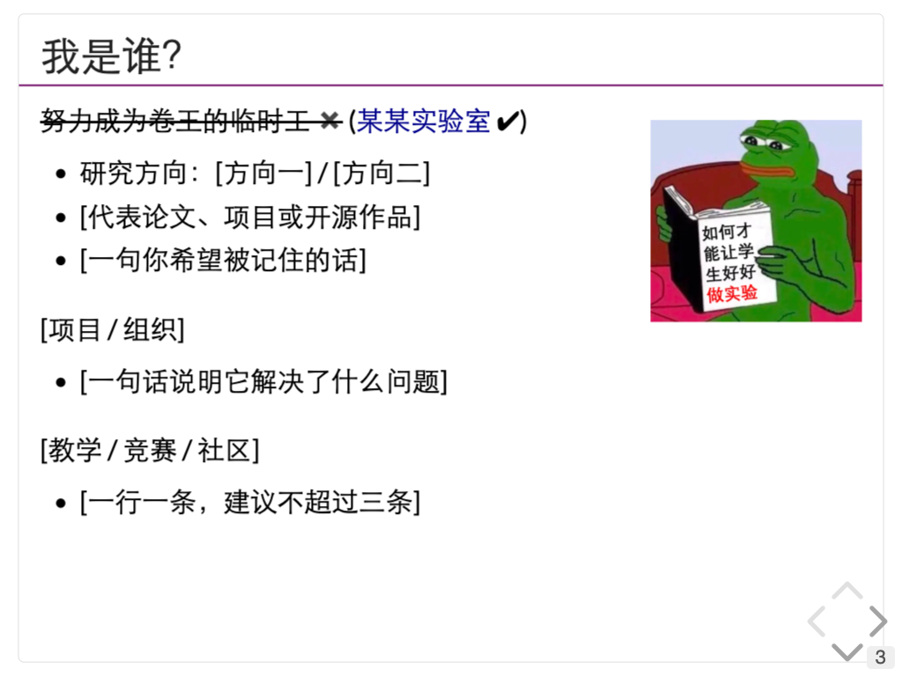

# Principia 的 Slides

用 Markdown 写内容，一条命令生成和参考图同一套主题的网页幻灯片（reveal.js），可导出 PDF，也可以直接部署到 GitHub Pages。



> 这个仓库是一个**可 fork 的定制版**：把名字、单位、颜色换掉，就是你们自己的模板。

---

## 0. 最快路径（做一份自己的）

```bash
bash scripts/setup.sh                 # 第一次：装依赖
bash scripts/new-deck.sh our-talk     # 从 demo 复制出 decks/our-talk.md
# 编辑 decks/our-talk.md 的 front matter 和正文
bash scripts/build.sh decks/our-talk.md
bash scripts/serve.sh                 # http://localhost:8000 预览
bash scripts/deploy.sh decks/our-talk.md
```

不想新建文件，就直接改 `decks/demo.md`，把 `decks/our-talk.md` 换成 `decks/demo.md` 即可。

---

## 1. 这个模板是哪来的

参考图不是 PowerPoint，而是 **reveal.js** 生成的网页幻灯片：

- 上游项目：**[zweix123/jyyslide-md](https://github.com/zweix123/jyyslide-md)**（MIT）
  - Python 把一套简化的 Markdown 编译成 reveal.js 网页
  - 主题 CSS 在 `src/static/jyy/jyy.css`：标题下的紫色横线、右下角页码、右下角翻页箭头，都来自这里
  - 本仓库基于上游 commit `7be02cd`
- 上游 `example/jyy/操作系统概述.md` 里有一页和参考图几乎一样的“我是谁？”，可以拿来对照
- 如果你更想要 **LaTeX / PDF**，而不是网页，可以看 **[tianxiaogu/beamertheme-njupurple](https://github.com/tianxiaogu/beamertheme-njupurple)**（南大紫 Beamer 主题）

本仓库在上游基础上做了这些事：

1. 新增 `src/static/jyy/custom.css`，把“换皮肤”集中到一个文件；
2. 页码改成只显示当前页（参考图右下角的 `43`），翻页箭头改成灰色；
3. 去掉了一个不存在的 `plugin/markdown/markdown.js` 引用；
4. front matter 支持 `title:`，单位 logo 变成可选项（没有 `img:` 就只显示文字）；
5. 用 `requirements.txt` + `scripts/` 替代 Poetry，少装一堆开发依赖。

---

## 2. 30 秒跑起来

需要 Python 3.10+。

```bash
cd slides-template

bash scripts/setup.sh     # 第一次：创建 .venv 并安装依赖
bash scripts/build.sh     # 编译 decks/demo.md -> decks/dist/
bash scripts/serve.sh     # 打开 http://localhost:8000
```

之后每次改完 `decks/demo.md`，只需要重新执行 `bash scripts/build.sh`，刷新浏览器即可。

> 为什么不用 `file://` 直接打开 `index.html`？
> 浏览器对本地文件的脚本/图片有限制，用 `serve.sh` 起一个本地 HTTP 服务最稳。

---

## 3. 只改三个地方，就变成你们的

### 3.1 内容：`decks/demo.md`

文件最上面是 front matter（作者、单位、浏览器标题）：

```yaml
title: 某某实验室 · 组会分享

author:
  name: 张三
  url: https://example.com/

departments:
  - name: 某某大学
    url: https://example.com/
  - name: 某某学院
    url: https://example.com/
  - name: 某某实验室
    url: https://example.com/
+++++
```

想显示单位 logo，就加 `img:`，图片放在 `decks/img/`：

```yaml
departments:
  - name: 某某大学
    url: https://example.com/
    img: ./img/logo.png
```

### 3.2 主色 / 字体：`src/static/jyy/custom.css`

```css
:root {
    --brand: #6a005f;  /* 改成你们的主色，比如 #0b5d8a */
    --font-sans: 'Lato', 'STHeiti', 'SimHei', 'Sans Serif';
}
```

改 `--brand` 会同时影响标题下划线、作者链接、引用页和翻页控件。

### 3.3 页面尺寸 / 页码：`src/backup/template/basetemp.html`

```js
width: 1024, height: 768,   // 4:3
slideNumber: 'c',           // 只显示当前页；'c/t' 显示 当前/总数
```

如果要改成 **16:9**：

1. 这里改成 `width: 1280, height: 720`；
2. 把 `src/static/jyy/jyy.css` 里 `.middle` 的 `height: 728px` 改成 `680px`。

---

## 4. 内容怎么写

| 写法 | 作用 |
| --- | --- |
| `---` | 新的一页（横向） |
| `----` | 同一节里的下一页（纵向，演讲时按 ↓） |
| `--` | 同一页里分步出现（fragment） |
| `# 标题` | 封面 / 章节分隔页（居中大字） |
| `## 标题` | 内容页标题（带紫色下划线） |
| `<hr>` | 段落之间的留白 |
| `` | 右浮动图片，文字绕排 |
| `<red>文字</red>` / `<del>文字</del>` | 标红 / 删除线 |
| `` `代码` `` / 代码块 | 行内代码 / 语法高亮 |
| `$...$` / `$$...$$` | 行内公式 / 块级公式（本地 KaTeX） |

最常用的骨架：

```markdown
# 章节标题

----

## 这一页的标题

+ 要点一
+ 要点二

<hr>

+ 要点三
```

---

## 5. 发布到 GitHub Pages

本仓库的在线版本：<https://ipoger.github.io/slides/>，发布在 `gh-pages` 分支上。

### 更新已发布的幻灯片

改完你要发布的 deck 后：

```bash
bash scripts/deploy.sh                     # 发布 decks/demo.md
bash scripts/deploy.sh decks/our-talk.md   # 发布指定文件
```

脚本会重新编译，并把对应 `dist/` 强制推到 `gh-pages` 分支，Pages 随后自动更新。

### 想改成 GitHub Actions 自动部署（可选）

`extras/pages.yml` 是现成的 workflow。把它放到 `.github/workflows/` 再 push 即可：

```bash
mkdir -p .github/workflows
cp extras/pages.yml .github/workflows/pages.yml
git add .github/workflows/pages.yml
git commit -m "ci: deploy slides"
git push
```

> 如果 push 报 `refusing to allow an OAuth App to create or update workflow`，
> 说明当前 `gh` token 没有 `workflow` scope：
> 运行 `gh auth refresh -h github.com -s workflow`，或者直接在 GitHub 网页上创建这个文件。
> 然后在 **Settings → Pages → Source** 选 **GitHub Actions**。

### 从零建一个新仓库

```bash
git init
git add .
git commit -m "init: our slides"
git branch -M main
git remote add origin git@github.com:<你的组织>/<仓库名>.git
git push -u origin main
```

如果只想本地/内网放，`decks/dist/` 整个目录就是纯静态站点，丢到任何 Web 服务器都能跑。


---

## 6. 导出 PDF

Reveal 自带打印排版，推荐用 Chrome：

1. `bash scripts/serve.sh`
2. 打开 `http://localhost:8000/?print-pdf`（注意 `?print-pdf`）
3. `Cmd/Ctrl + P` → 目标打印机选“另存为 PDF”
4. 边距选“无”，勾选“背景图形”

也可以命令行：

```bash
"/Applications/Google Chrome.app/Contents/MacOS/Google Chrome" \
  --headless --disable-gpu --no-pdf-header-footer \
  --print-to-pdf=slides.pdf \
  "http://localhost:8000/?print-pdf"
```

> 打印前等一两秒，让 KaTeX 和字体加载完。

---

## 7. 为什么不是 `.pptx`？

因为这套东西的强项是**网页/PDF**：代码高亮、公式、链接、动画、手机/投影自适应都更自然；代价是不能在 PowerPoint 里拖控件。

如果主办方硬性要求 `.pptx`，有三个选择：

1. **导出 PDF 去讲**（大多数场合够了）；
2. 用本模板确定视觉风格，再在 PowerPoint 里做一个 10 分钟的母版（标题线、页码、字体），内容照搬；
3. 换用 Marp / Slidev 这类能导出 pptx 的工具，但主题就不是这一套了。

---

## 8. 目录结构

```
slides-template/
├── decks/
│   ├── demo.md              # 你主要改这个
│   └── img/                 # 图片、logo
├── src/
│   ├── converter.py         # Markdown -> HTML
│   ├── backup/template/     # 页面模板（尺寸、页码、作者页）
│   └── static/
│       ├── jyy/
│       │   ├── jyy.css      # 上游主题
│       │   └── custom.css   # 你的皮肤（主色/字体/页码）
│       ├── reveal/          # reveal.js 4.0.2
│       └── katex/           # 本地公式渲染
├── scripts/
│   ├── setup.sh
│   ├── new-deck.sh          # 从 demo 复制一份新 deck
│   ├── build.sh
│   ├── serve.sh
│   └── deploy.sh            # 发布到 gh-pages
├── extras/pages.yml         # 可选：GitHub Actions workflow
├── requirements.txt
└── License
```

---

## 9. Credits & License

- 主题复刻：[zweix123/jyyslide-md](https://github.com/zweix123/jyyslide-md)（MIT）
- 原始设计：[蒋炎岩](https://jyywiki.cn/) 老师的操作系统课程幻灯片
- [reveal.js](https://revealjs.com/)（MIT）、[KaTeX](https://katex.org/)（MIT）、[Tailwind CSS](https://tailwindcss.com/)（MIT）
- `decks/img/pepe.jpg` 来自上游示例，仅作演示；正式使用建议换成你们自己的图

本仓库同样以 **MIT** 发布，见 [License](License)。如果二次分发，请保留上游版权声明。
