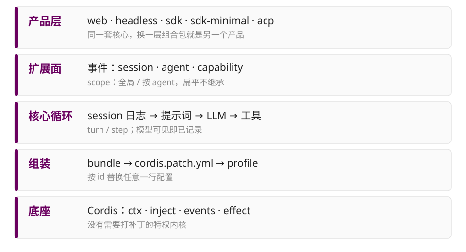
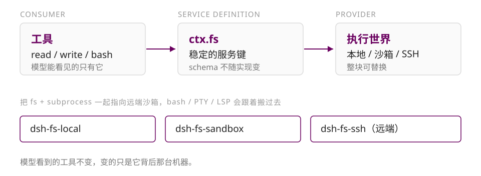

title: DeepSeek Harness · 架构速览

author:
  name: 牟安阳
  url: https://ipogermay.cn/

departments:
  - name: 上海交通大学
  - name: 设计学院
+++++

# DeepSeek Harness

<p class="center">把 Agent 拆成可组装的零件</p>

---

## 先说结论

+ 它不是"更大的 Agent"，而是 **Agent 的底座**
+ 模型、工具、会话、执行环境、策略，全部是插件
+ 换一层组合包就是另一个产品，加一个插件就是新能力

<hr>

<p class="center" style="font-size:26px; color:#6a005f; margin-top:26px">58 个包 · 68 个模型可见工具 · 5 种 profile · 480+ 篇双语文档</p>

---

## 全貌：五层



<p class="center" style="font-size:22px; color:#888; margin-top:6px">五层各管一件事：产品、扩展、循环、组装、底座</p>

---

## 01　一切皆插件

+ 插件是实现 Service 的对象，函数或类都可以
+ 上下文是服务容器，每个服务占一个稳定的 `ctx.<key>`
+ `inject` 声明依赖，启动顺序由依赖决定
+ 事件是类型化的，有五种分发方式
+ 注册是可逆的副作用，卸载时自动撤销

<hr>

连 agent loop 本身也是插件：`ctx.agentLoop` 可以被整个换掉。

---

## 02　没有特权内核

+ **profile**：具名组装，列出自己要叠的组合包
+ **bundle**：配置项加挂载代码，插入的内容总能被上层 patch
+ **patch**：按 id 找到条目，替换整段 config，或插入新条目

<hr>

叠加顺序：bundle → profile patch → home patch → `--patch`

```sh
dsh --profile web --dump-config
```

打印出来的任何一行，都可以被你替换。

---

## 03　日志是唯一真源

+ 会话日志只追加：`turn/*`、`message`、`tool/*`
+ 模型历史由 `deriveMessages()` 从日志投影
+ fork、resume、transcript、telemetry 都从同一份日志派生
+ 想改消息内容，注册纯消息投影，而不是改 UI

<hr>

<p class="center" style="font-size:42px; color:#6a005f; margin-top:18px">模型可见即已记录。</p>

---

## 04　一次轮次

+ **步骤**：一次模型请求，加上它引发的工具执行
+ **轮次**：0 到 n 个步骤，从认领输入开始，到不再欠工作结束

```text
turn/start
  └─ pre-step → request → stream → tool → 下一步
turn/end
```

<hr>

重试不重复组装；取消不提交系统提示与用户消息。

---

## 05　能力 seam



<p class="center" style="font-size:36px; color:#6a005f; margin-top:10px">seam 是三角整体，不是其中一个角色。</p>

---

## 06　事件就是扩展点

| 事件域 | 回答什么 | 例子 |
| --- | --- | --- |
| `session/event` | 留下什么事实 | `turn/start`、`tool/result` |
| `agent/*` | 能不能拦截 | `pre-step`、`request` |
| `fs/*`、`tools/*` | 挂什么策略 | `pre/post-execute` |

<hr>

waterfall 是环绕中间件：不调用 `next()` 就是短路。

---

## 07　工具流水线

+ 三个阶段：`pre-execute` → `execute` → `post-execute`
+ 审批结果只有四种，拿不到明确许可就拒绝
    + `allowed-once` / `rejected` / `cancelled` / `unavailable`
+ 沙箱只负责文件效果，不负责网络与进程可见性

```text
read-only · workspace-write · danger-full-access
```

每次调用解析一份策略，带着 workspaceRoot 一起走。

---

## 08　一个 Agent 一套能力

+ 只有两层：全局，或归属于某个 agent 的 scope
+ 扁平，不向下继承；父子关系是 lineage 数据
+ shadowing：同名时最具体者胜
+ restriction：为单个 scope 过滤全局工具，多个取交集

<hr>

给一个 agent 定制人格和工具，不需要复制一套产品。

---

## 09　产品是组合出来的

+ 并行探索：`ctx.subagents` → `subagent` / `subagent_fork`
+ 长期目标：`ctx.goals` → `create_goal`，Goal Round 自动续跑
+ 后台任务：`ctx.jobs` → `job_list` / `job_output` / `job_kill`
+ 多步编排：`ctx.workflowEngine` → `workflow` / `ralph`
+ 领域知识：`ctx.skills` → `skill`

<hr>

没有一张"Agent 功能列表"的文件，只有一层层组合。

---

## 10　文档也是门禁

+ 480+ 篇文档，中英双语逐篇配对校验
+ tool catalog 由真实启动的插件生成，完整性守卫覆盖所有 tool 包
+ 子系统页的 mermaid 图由脚本生成，不靠手画
+ snapshot 与 e2e 测试锁住事件和配置的形状

<p class="center" style="font-size:38px; color:#6a005f; margin-top:30px">文档不是描述，是构建的一部分。</p>

---

## 三句话

+ **机制与产品分离**：profile + bundle + patch
+ **事实与视图分离**：会话日志是唯一真源
+ **能力与实现分离**：seam + 事件 + scope

<hr>

DSH 的价值不在"它有什么功能"，而在"加功能不需要改它"。

---

# 谢谢

<p class="center">https://github.com/deepseek-ai/deepseek-harness</p>

<p class="center">https://deepseek-harness.github.io/deepseek-harness/</p>
