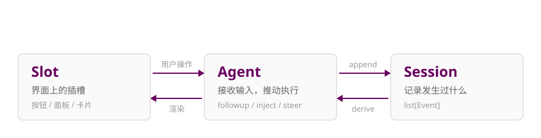
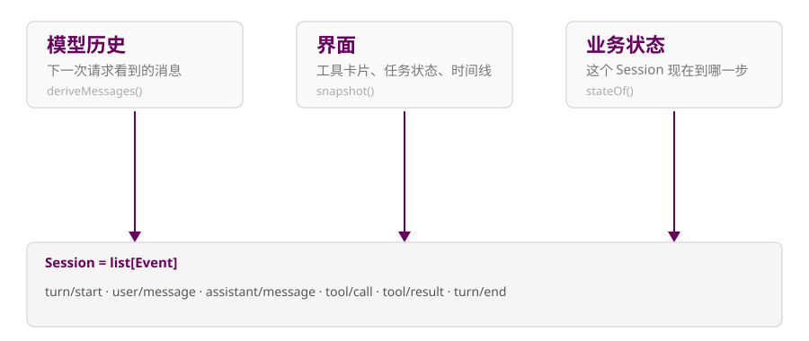
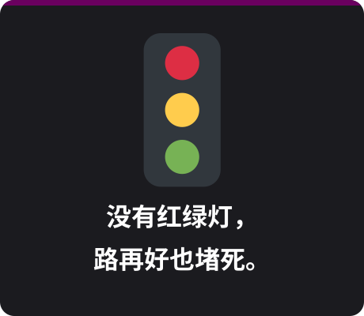
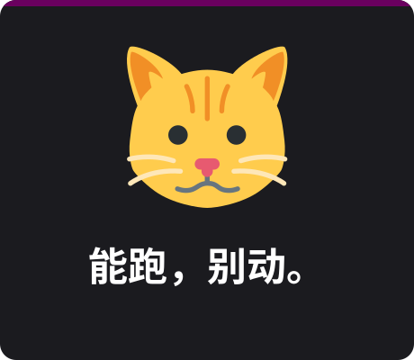

title: DeepSeek Harness · 一个小循环的成人礼

author:
  name: 牟安阳
  url: https://ipogermay.cn/

departments:
  - name: 上海交通大学
  - name: 设计学院
+++++

# DeepSeek Harness

<p class="center">一个小 Agent 循环，怎么活过真实世界？</p>

<p class="center" style="font-size:22px;color:#999">（以及它为什么最后变成了一堆插件）</p>

---

## 150 行，真的能跑

```python
while True:
    reply = model(messages)
    if not reply.tool_calls:
        break
    messages += run(reply.tool_calls)
```

+ 模型不只是“说”，它还能改你的工作区
+ jyy 课程 demo：让 Agent 生成一个“相对真实”的南大仙林 3D 图
+ **能跑。别动。**

<p style="color:#888;font-size:26px;margin-top:14px">（先别问权限、沙箱、并发——它连网线都怕。）</p>

---

## 然后，它寄了


<div style="max-width:600px" markdown="1">

+ 网络断了 → 直接退出
+ 权限不足 → 重试也没用
+ **没收到成功消息 ≠ 没执行**

<br>

于是你开始写重试、幂等、恢复……然后发现，这只是需求清单的第一行。

</div>
---

## Quiz：这些需求，哪些该进主循环？

+ 项目管理、工具与 Skills、沙箱与权限
+ 上下文压缩、记忆与索引、文件编辑
+ 远程访问、App 同步、备份与恢复

<hr>

**一个都不该。**

它们应该长在循环周围，而不是塞进循环里面。（除非你喜欢 if-else 圣诞树 🎄）
---

## 需求还会突然换方向


<div style="max-width:600px" markdown="1">

+ 昨天：打开项目，写代码
+ 今天：晨报、新闻、定时、协作
+ 明天：？

<br>

“之前的需求全崩了。” —— 一句夸张但贴切的感叹。

</div>
---

## 架构：用一部分自由，换一类便利

+ **进程**：不能改别人的内存，但四个程序可以同时活着
+ **Java GC**：不用手动 free，但要在暂停和吞吐之间取舍
+ **LAMP**：请求-响应很顺，长连接一来就露馅

<hr>

便利不是白来的，它绑定了一组假设。假设变了，抽象就漏。

---

# Everything is a plugin

<p class="center">然后，真正难的事情才开始。</p>

---

## 插件化，到底换来了什么

+ **换实现**：`ctx.fs` 指向远端沙箱，bash / PTY / LSP 一起搬走
+ **换能力**：给一个 agent 挂工具，不用复制一套产品
+ **换产品**：换一层组合包，web → headless → sdk → acp

<hr>

同一套核心，三种自由。

<p style="font-size:26px;color:#888;margin-top:12px">换实现，就像换插座：墙上的孔不变，后面接哪路电可以换。</p>

---

## 但拆成插件 ≠ 自动解耦


<div style="max-width:600px" markdown="1">

+ 不协同：四座孤岛
+ 乱协同：一锅粥
+ 拆成 58 个包 ≠ 有架构

<br>

**真正难的不是“插件化”，是“协同”。**

</div>
---

## DSH 的世界模型



<p class="center" style="font-size:22px;color:#888;margin-top:6px">插件不必知道彼此的全部内部结构，也能参与同一段工作。</p>

---

## Session = list[Event]



<p class="center" style="font-size:32px;color:#6a005f;margin-top:10px">余额是算出来的，不是改出来的。</p>

---

## 给模型一段话，其实有三种说法

+ `followup`：新任务，排进下一轮，唤醒
+ `inject`：补充资料，等下一步用，不唤醒
+ `steer`：中途变道，“先处理第二份文件”

<hr>

类比：发新工单 / 往桌上放资料 / 跑到工位旁边喊一声。

---

## 过去和未来，不要混在一起

+ `session/event`：已经发生的事实，只能追加
+ `agent/pre-step`：还没发生的步骤，可以参与决策
+ 改写历史 → 留下新记录；改变未来 → 参与决策
+ 不调用 `next()`，就是短路

<hr>

类比：监控录像 vs 导演喊“卡”。

---

## 插件挂上总线，冲突也一起进来


<div style="max-width:600px" markdown="1">

+ A 改写，B 检查：顺序不同，看到的就不同
+ 一个说继续，一个说停
+ 十个压缩插件：$(1/2)^{10}=1/1024$

<br>

每个插件都觉得自己在省上下文，合起来把信息压没了。

</div>
---

## 所以，“彻底解耦”是一句假话



<div style="max-width:600px" markdown="1">

+ 谁负责哪类事件
+ 哪些行为能共存
+ 冲突时谁说了算
+ 卸载后清理什么

<br>

接口可以小，规则不能少。

</div>
---

## 生态：让用户在现场试错

+ 用户许愿 → Agent 写插件 → 用户现场体验
+ 共同接口足够小，小需求不必等排期

<hr>

> “我觉得 dsh 的开源社区走远了。” —— jyy

<hr>

是在收集插件，还是在让每个人满足自己的小需求？

---

## 三个老问题，换了身衣服

| 领域 | 老办法 | 在 DSH 里 |
| --- | --- | --- |
| 会计 | 流水账 | Session / 投影 |
| 快递 | 一个单号 | 幂等重试 |
| 电影 | 录像与喊卡 | 事实 vs 决策 |
| 交通 | 红绿灯 | 协同规则 |

<hr>

DSH 没有发明新问题，只是把老问题放进了 Agent 里。

---

## 如果只记三句话



<div style="max-width:600px" markdown="1">

+ 核心很小，世界很大
+ 插件管加法，规则管打架
+ 架构是交换，不是白送

<br>

<p class="center" style="font-size:38px;color:#6a005f;margin-top:10px">能跑，只是开始。</p>

</div>
---

# 谢谢

<p class="center">去写一个自己的插件吧。</p>

<p class="center">https://github.com/deepseek-ai/deepseek-harness</p>

<p class="center" style="font-size:18px;color:#aaa;margin-top:18px">表情素材：Twemoji (CC BY 4.0) · 风格参考 jyywiki.cn</p>
